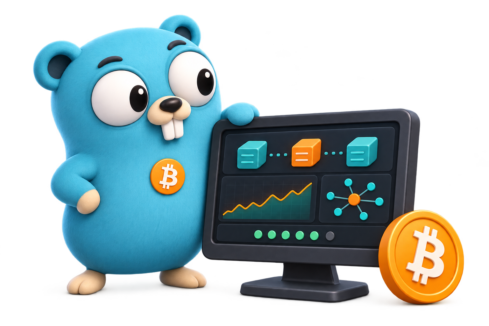

<div align="center">

<h1>Nodarium</h1>

<p>
  A lightweight, self-hosted Bitcoin node explorer for keeping an eye on your Bitcoin Core node.
</p>

<p>
  
</p>

</div>

## Features

- **Mempool:** Live opens with local fee estimates for 2, 3, and 6-block targets, projected next blocks, and sampled transaction arrivals. Trends collects fee, backlog, memory, and acceptance-floor history.
- **Blocks:** Explorer provides height search, virtual-scrolling block history, and transaction inspection. Analytics compares utilization, fee rates, subsidy and fees, and fee share.
- **Mining:** Network shows difficulty-period progress, estimated adjustment time, hashrate, and difficulty history. Pools shows recent observed shares, historical trends, and pool detail pages.
- **My node:** Overview shows health, synchronization, blockchain and Nodarium database size, uptime, and Core details. Peers combines searchable connections and geography; Traffic combines download/upload history and budget readings; Events retains the 30-day observation timeline.

Nodarium monitors one node per instance; PostgreSQL is optional. Monitoring history begins when collection starts and is retained for up to a year. Block summaries are backfilled from Core and retained across restarts. Mempool Live and My node Events use optional ZMQ with RPC fallback and SSE updates. See [Live tracking and Events setup and coverage](docs/activity.md). No wallet features, peer controls, or host-resource monitoring.

## Dashboard navigation

The sidebar lists Mempool, Blocks, Mining, and My node. `/` opens Mempool Live.

| Destination | Views |
| --- | --- |
| Mempool | Live `/mempool`, Trends `/mempool/trends` |
| Blocks | Explorer `/blocks`, Analytics `/blocks/analytics` |
| Mining | Network `/mining`, Pools `/mining/pools` |
| My node | Overview `/node`, Peers `/node/peers`, Traffic `/node/traffic`, Events `/node/events` |

Views have separate URLs. Retired and unknown page URLs show a localized page-not-found view without redirects. History ranges are remembered per view for the browser tab when session storage is available. Pool details retain their historical range in the URL and return to Pools with that range; block analytics remembers its own range.

“Pause live tracking” holds the current projection and sampled arrivals; independently polled fee estimates and node readings continue. Mempool details and policy readings remain available in Live’s final disclosure. Traffic totals are Core’s cumulative counters, distinct from the collected rate history.

The header’s remembered BTC/EUR/USD selector optionally adds approximate fiat values below BTC amounts on mainnet. BTC is the default and keeps conversions off; fee rates stay in sat/vB and chart axes stay in BTC. Native hover metadata on displayed fiat amounts gives the quote’s source, as-of time, and current-rate basis. Current quotes also convert historical BTC amounts, so these are not historical exchange valuations.

Prices are periodic provider snapshots, requested through Nodarium’s authenticated `/api/1.0/fiat-rates` endpoint only while a fiat currency is selected on mainnet. Browser polling and the server cache use one-minute intervals; upstream requests time out after five seconds. No node, transaction, or peer details are sent to the price service. Failed refreshes retain the last quote marked stale; quotes older than two hours are also stale. Without a quote, BTC remains available and fiat shows unavailable. Testnet and regtest have no fiat valuations or rate requests.

## Quick start

Requires Docker Compose and Bitcoin Core 28+ with RPC enabled.

```sh
git clone https://github.com/Primexz/nodarium.git
cd nodarium
cp .env.example .env
openssl rand -hex 32
```

Use the generated key for `ADMIN_KEY`, then set your node connection in `.env`:

```dotenv
ADMIN_KEY=YOUR_GENERATED_ADMIN_KEY
BITCOIN_RPC_URL=http://host.docker.internal:8332
BITCOIN_RPC_USER=monitor
BITCOIN_RPC_PASSWORD=YOUR_RPC_PASSWORD
```

Start the dashboard and open [localhost:8080](http://localhost:8080):

```sh
docker compose up -d --build
```

Log in with your admin key. Compose binds to localhost by default and stores data in the `monitor-data` volume. Set `BIND_ADDRESS` to your private LAN or VPN address for access from other devices. `docker compose down` preserves history; `docker compose down -v` deletes it.

### Bitcoin Core connection

Enable `server=1` and configure RPC credentials in `bitcoin.conf`, using `rpcauth` or `rpcuser`/`rpcpassword`. Core must listen on an interface reachable from Nodarium, and `rpcallowip` must permit the dashboard's source address or subnet. Restart Core after configuration changes.

Use `host.docker.internal` for the Docker host, a service name for another container on the same Docker network, or a private address for a remote node. Container `localhost` refers to Nodarium itself. Keep RPC access restricted to a private network or VPN.

## Configuration

See [.env.example](.env.example) for settings. Apply changes with `docker compose up -d`.

| Setting | Purpose |
| --- | --- |
| `NODE_IP`, `NODE_LOCATION_NAME` | Public IP and label for your node on the map. Without an IP, Core's advertised addresses are tried. |
| `DB_DRIVER`, `DB_DSN` | Defaults to SQLite. For PostgreSQL, set `DB_DRIVER=postgres` and a connection string. Changing databases does not migrate history. |
| `GEOIP_DB_PATH`, `GEOIP_AUTO_DOWNLOAD` | Custom city MMDB file or automatic DB-IP City Lite downloads. |
| `BITCOIN_ZMQ_SEQUENCE_URL` | Optional Core sequence endpoint, e.g. `tcp://host.docker.internal:28332`; enables instant activity events with RPC fallback. |
| `POLL_INTERVAL` | Collection interval; defaults to `10s`. |
| `BLOCK_INDEX_DELAY` | Optional pause between indexed blocks; defaults to `0s`. Increase it, e.g. `25ms`, to reduce indexing load. |
| `LOG_LEVEL` | `debug`, `info`, `warn`, or `error`; defaults to `info`. |
| `COOKIE_SECURE` | Set to `true` behind an HTTPS reverse proxy. Serve at the domain root and preserve the Host header. |
| `BIND_ADDRESS`, `PORT` | Compose host address and port; defaults to `127.0.0.1:8080`. |

My node Overview shows Nodarium’s database size beside blockchain disk usage. SQLite includes the main database and its WAL/SHM journal files; in-memory SQLite shows allocated database pages labeled as memory. PostgreSQL reports the entire configured database, including other schemas or tables if it is shared. The reading refreshes each collection cycle independently of Core health; a failed refresh keeps the last size marked stale, and an absent reading shows unavailable.

IP geolocation runs locally. Peer and node addresses are never sent to a geolocation service. DB-IP City Lite is downloaded and cached by default; Tor, I2P, private, and unknown addresses remain unlocated. Locations and connection lines are approximate.

Pool names are inferred locally from coinbase tags or payout addresses using the official [mempool mining-pool definitions](https://github.com/mempool/mining-pools). Unknown matches stay Unknown. Pool shares count observed mainnet blocks, not measured hash power. Refresh the bundled definitions with `make update-mining-pools`, then rebuild and restart.

Pool logos come from a bundled snapshot of [mempool/mining-pool-logos](https://github.com/mempool/mining-pool-logos). Refresh them with `make update-mining-pool-logos`, then rebuild and restart. Browsers load logos locally; missing artwork uses a neutral icon.

Block and transaction details come from your node without requiring `txindex`. A background indexer starts after synchronization, reads recent blocks first, and works backwards to genesis with resumable progress. Economics charts compare subsidy, fees, fee rates, and fullness over recent blocks or long-term ranges. Block summaries persist indefinitely; transaction mosaics and details load on demand from Core. Pruned blocks or unavailable undo data can limit historical statistics and goggles. Missing readings and partial samples are labeled instead of filled with invented values. See the [block history and API details](docs/block-history.md).

To follow logs:

```sh
docker compose logs -f dashboard
```

### Container images

CI publishes verified `master` builds and version tags to `ghcr.io/primexz/nodarium` for amd64 and arm64. To use a published image, set `NODARIUM_IMAGE=ghcr.io/primexz/nodarium:master` in `.env`, then run:

```sh
docker compose pull dashboard
docker compose up -d --no-build
```

## Development

Requires Go 1.26.2+, a C compiler for SQLite, Node 22.13+ (24 recommended), and pnpm 11.19.0.

```sh
corepack enable
make build
# Export your trusted .env settings into the shell before running:
DATA_DIR=./data go run ./cmd/nodarium
```

For frontend development, run `pnpm --dir web dev` alongside the backend. Vite proxies `/api` to port 8080. Go embeds the frontend, so build it before compiling the backend.

```sh
make format-check
make test
pnpm --dir web exec playwright install chromium
pnpm --dir web test:e2e
```

Browser tests use a local RPC fixture. `scripts/integration.sh` runs disposable PostgreSQL and Bitcoin Core regtest containers. Storage tests must use an isolated test database.

## License

[MIT](LICENSE), copyright 2026 Primexz. Third-party notices remain with their assets: [mining-pool definitions](internal/miningpool/data/LICENSE), [pool logos](web/src/assets/mining-pool-logos/NOTICE.txt), and [map attribution](web/public/map-attribution.txt).

The README illustration adapts the [Go Gopher by Renee French](https://go.dev/blog/gopher), licensed under [CC BY 4.0](https://creativecommons.org/licenses/by/4.0/).
